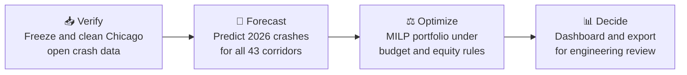
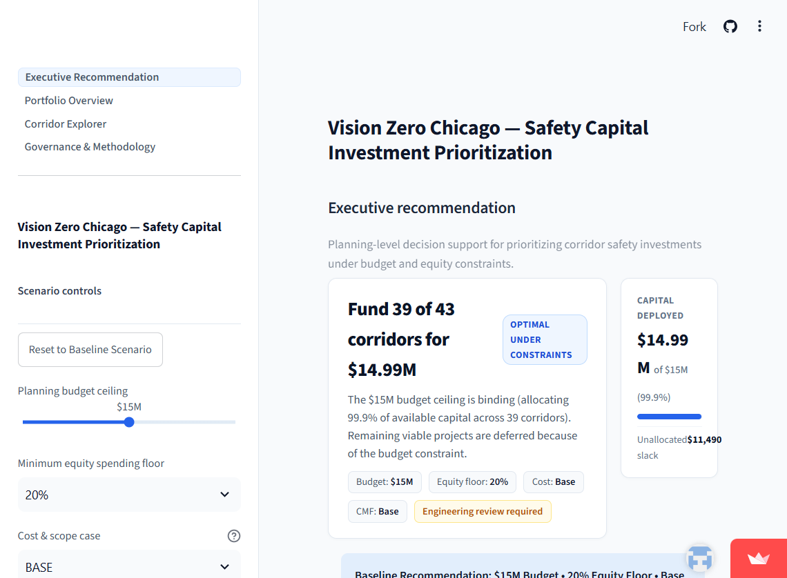
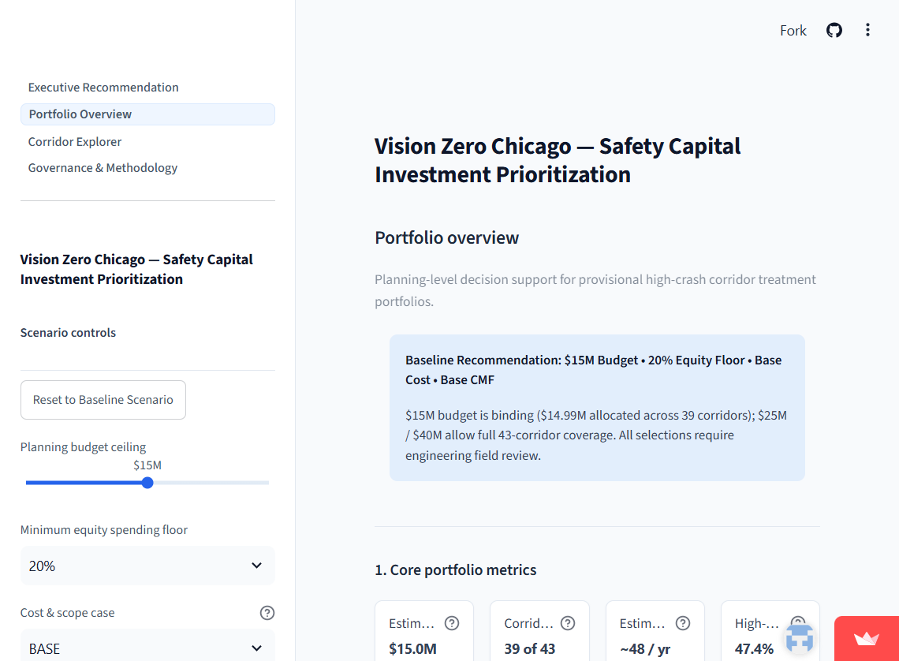
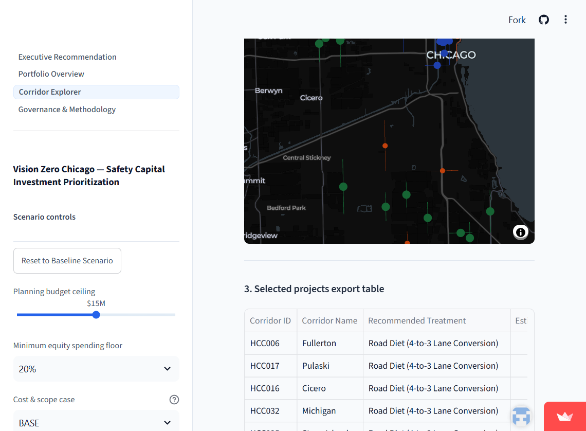
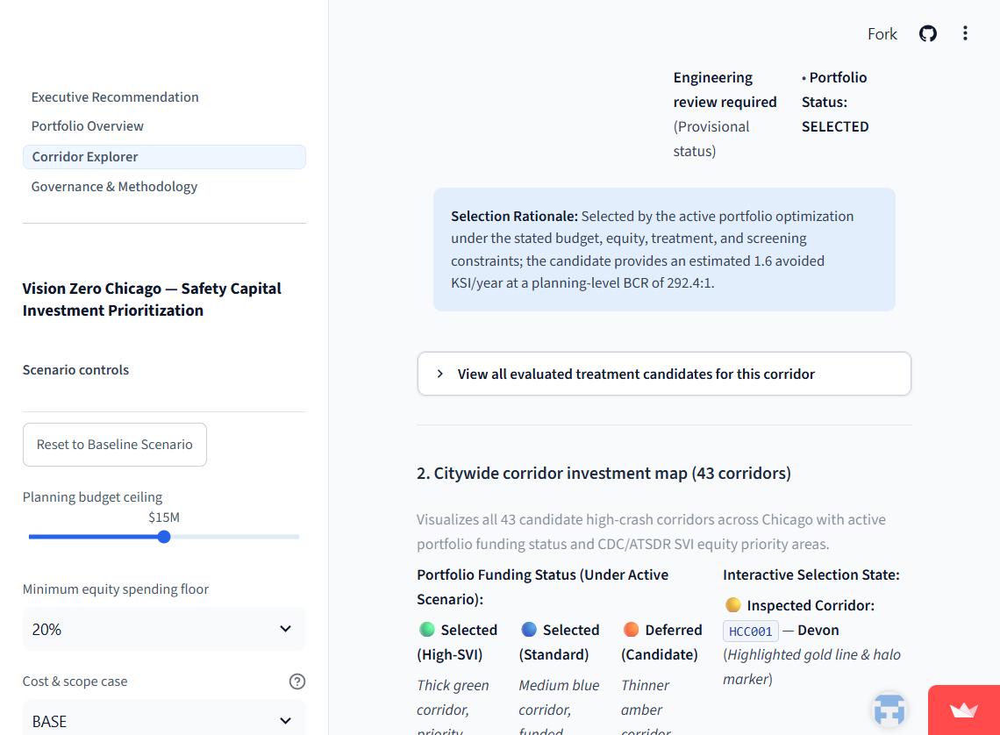
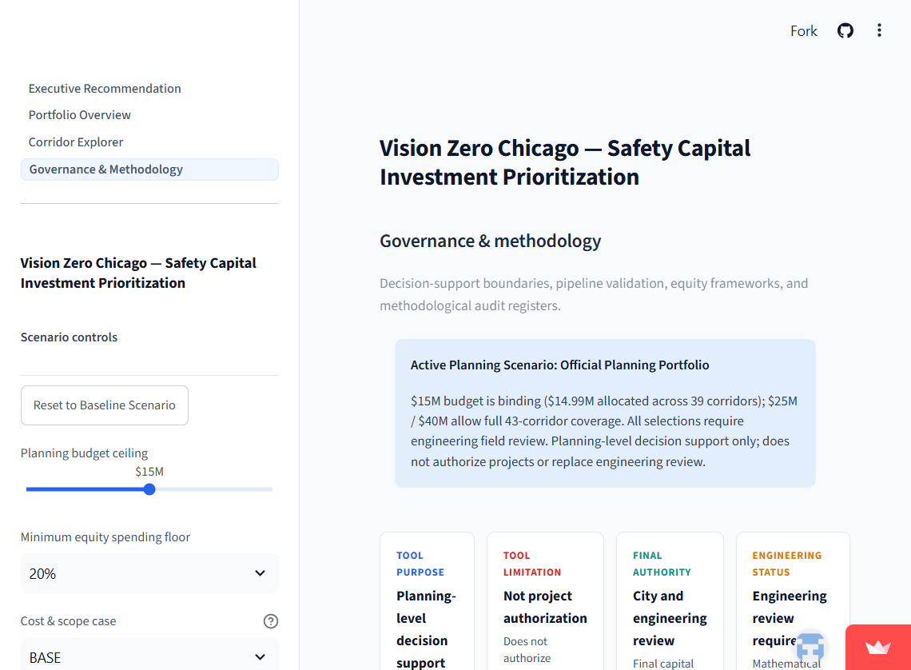

# Chicago Road Safety Investment Prioritizer

**Vision Zero Chicago — road-safety investment decision support**

[](https://github.com/charankumar-17A/vision-zero-chicago/actions/workflows/ci.yml)
[](https://vision-zero-chicago-17a.streamlit.app/)
[](https://www.python.org/)
[](https://github.com/charankumar-17A/vision-zero-chicago/actions)

> Chicago can't fund every high-crash corridor. This tool makes the trade-offs **transparent, measurable, and auditable** — instead of a gut-feeling wish list.

**🖥 Live dashboard:** [vision-zero-chicago-17a.streamlit.app](https://vision-zero-chicago-17a.streamlit.app/)

---

## What this does in 30 seconds

1. **Forecasts** where crashes are headed — a validated 2026 crash forecast for each of Chicago's 43 official high-crash corridors.
2. **Matches** every corridor with the treatment most likely to reduce harm there, using federal Crash Modification Factors (CMFs).
3. **Optimizes** the fundable portfolio — a mathematical program (MILP) selects the best mix of projects under a $15M budget ceiling and a 20% equity-spending floor.
4. **Shows its work** — every assumption, validation check, and governance warning is published on a public dashboard for engineering review.

> ⚠️ This is decision **support**, not decision **authority**. Final project selection remains with City staff and qualified transportation-engineering teams.

## Headline results

*Baseline scenario: $15M budget · 20% equity floor · Base cost · Base CMF — as verified in the live dashboard and the final report.*

| Result | Verified value |
|---|---|
| Corridors funded | **39 of 43** |
| Capital allocated | **$14.99M** — 99.9% of the $15M budget (binding) |
| Spend directed to high-vulnerability (SVI) communities | **47.4%** (floor was 20%) |
| Fatal & serious-injury (KSI) crashes avoided | **≈ 48 per year** |
| Total crashes avoided | **≈ 2,170 per year** |
| 20-year present-value safety benefit | **$4.00B** |
| Portfolio benefit-cost ratio | **267 : 1** |

💡 At $25M or $40M budgets, all 43 corridors can be funded — the $15M scenario is the only one where the budget binds and forces real trade-offs. That is a documented governance finding, not a limitation.

## How it works



Every stage is guarded by **327 automated acceptance tests** and a mandatory verification protocol — the same checks that gate every push in CI (badge above).

## Inside the dashboard

**Executive Recommendation — the funded portfolio at a glance**



**Portfolio Overview — where the $14.99M goes, and how scenarios shift it**



**Corridor Explorer — corridor drilldown with decision rationale, the citywide investment map, and the export table**



**Every recommendation ships with its measurable rationale** — e.g. corridor HCC001 (Devon): *selected by the active portfolio optimization, estimated 1.6 avoided KSI/year at a planning-level BCR of 292.4:1*



**Governance & Methodology — guardrails before charts: purpose, limitations, authority, engineering status**



---

## Project Purpose

Chicago has a limited road-safety budget and cannot fund every high-crash
corridor.

This project:

1. Forecasts where future crash burden is likely to be highest across the 43 official high-crash corridors.
2. Evaluates which road-safety treatment could deliver the greatest benefit for each corridor.
3. Recommends a combination of projects within a selected planning budget and equity spending requirement.
4. Produces a transparent, reproducible shortlist for City and engineering review.

The system supports decision-making. It does not automatically approve projects.
Final project selection remains with the City and qualified transportation-engineering teams.

## Business Decision

Which combination of corridor-level road-safety projects should be shortlisted
for engineering review under a limited budget and an equity requirement?

## Full Analytical Workflow

1. Verify and freeze source data.
2. Clean crash and supporting datasets.
3. Assign crashes to candidate corridors.
4. Create a balanced corridor-month panel.
5. Validate data quality and spatial assignments.
6. Engineer time-safe predictive features.
7. Train and evaluate count-forecasting models.
8. Produce a 12-month corridor crash forecast.
9. Estimate treatment safety and economic benefits using documented CMFs and crash costs.
10. Optimize the project portfolio under budget and equity constraints (MILP).
11. Publish results through Power BI and Streamlit.
12. Preserve the final decision record for City and engineering review.

## Expected Dataset Sizes

| Dataset | Expected grain | Expected rows |
|---|---|---:|
| Historical panel | 43 corridors × 96 months | 4,128 |
| Production forecast | 43 corridors × 12 months | 516 |

These counts are validation targets. They must be revised if the verified source
data changes the project boundary.

## Planning Scenarios

| Budget | Equity floor | Uncertainty |
|---|---|---|
| $15M / $25M / $40M | 20% / 30% / 40% equity spend | Conservative / Base / Optimistic CMF |

Scenarios are planning tools. They are not official City of Chicago budget commitments.

## Main Tools

- Python
- pandas and NumPy
- GeoPandas and Shapely
- scikit-learn
- statsmodels
- SciPy (MILP portfolio optimization)
- pytest
- DuckDB
- Power BI
- Streamlit
- GitHub Actions (Automation)
- Git and GitHub

## Repository Structure

- `config/` — Project configurations, spatial thresholds, CMF parameters, and cleaning rules
- `data/` — Data pipeline storage (immutable `raw/`, staged `interim/`, validated `processed/`)
- `docs/` — Decision register (`decision_log.csv`), methodological contracts, and run-level validation JSONs
- `notebooks/` — Reproducible exploratory data analysis and spatial/portfolio diagnostics
  (01 crash EDA, 02 corridor profiles, 03 feature importance, 04 spatial analysis,
  05 portfolio comparison, 08 treatment diversity diagnostic, 09 hindsight backtest)
- `src/` — Production Python pipeline modules:
  - `src/data/` — Source verification, coordinate cleaning, spatial assignment, and mart builders
  - `src/features/` — Time-safe corridor-month feature engineering
  - `src/models/` — Empirical Bayes shrinkage and crash risk forecasting
  - `src/treatments/` — Treatment readiness scoring and CMF safety benefit calculations
  - `src/optimization/` — MILP capital allocation and equity-floor optimization
  - `src/validation/` — Automated quality validation scripts
- `tests/` — Automated pytest verification suite (327 acceptance tests)
- `sql/` — Analytical and serving SQL views for DuckDB and Power BI
- `dashboard/` — Interactive decision-support interface:
  - `dashboard/streamlit/` — Four-page Streamlit application deployed to Streamlit Community Cloud;
    includes 2026 pre-treatment crash forecast baseline context, ranked corridor risk table,
    live MILP portfolio optimizer, scenario sensitivity analysis, and governance audit log
  - `dashboard/powerbi/` — Power BI template and workbook documentation
- `automation/` — Verification scripts and automated pipeline orchestration
- `reports/` — Authoritative technical report (`vision_zero_technical_report.md`)
- `outputs/` — Generated forecasts, summary tables, figures, and execution logs

## Data Sources

| Source | Provider | Use |
|---|---|---|
| Traffic Crashes — Crashes | City of Chicago Data Portal | Primary crash records |
| Traffic Crashes — Vehicles | City of Chicago Data Portal | Unit-level crash detail |
| Traffic Crashes — People | City of Chicago Data Portal | Person-level injury classification |
| Street Center Lines | City of Chicago Data Portal | Corridor geometry |
| CDC/ATSDR Social Vulnerability Index 2022 | CDC/ATSDR | Equity area designation |
| FHWA Crash Modification Factors | Federal Highway Administration | Treatment effectiveness evidence |
| FHWA Proven Safety Countermeasures | Federal Highway Administration | Treatment eligibility framework |

## Run It Locally

**Prerequisites:** Python 3.13 and Git.

```powershell
git clone https://github.com/charankumar-17A/vision-zero-chicago.git
cd vision-zero-chicago
python -m venv .venv
.\.venv\Scripts\Activate.ps1
pip install -r requirements-lock.txt

# run the full acceptance suite (the same gate used in CI)
python -m pytest -q

# launch the dashboard locally
streamlit run dashboard/streamlit/app.py
```

CI additionally runs `automation/verify_project.ps1` — the project's mandatory
governance verification protocol.

## Governance & Responsible Use

- The system **supports** decision-making; it does not automatically approve, authorize, or fund projects.
- Final project selection remains with the City and qualified transportation-engineering teams.
- All figures are planning estimates built on provisional unit costs, national CMF evidence, and physical-applicability assumptions not verified by engineering field survey.
- The method, assumptions, limitations, and governance warnings are published and auditable — the analysis is designed to be engaged with, not accepted as a black box.
